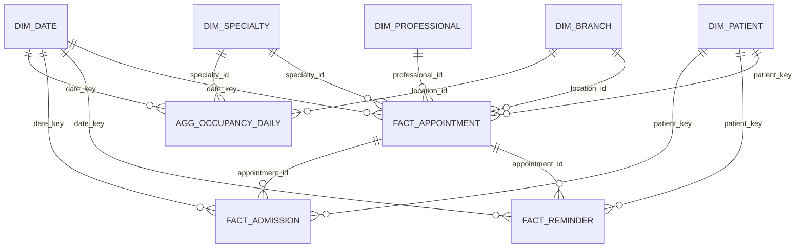
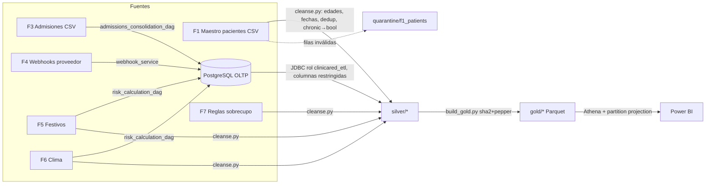

# Modelo dimensional (US 06 – Tarea 1): esquema estrella, diccionario y linaje

## 1. Diagrama



| Tabla | Grano | Partición |
|---|---|---|
| `fact_appointment` | 1 fila por cita | `year_month` de la cita |
| `fact_reminder` | 1 fila por mensaje saliente (recordatorio u oferta) | `year_month` de envío |
| `fact_admission` | 1 fila por admisión F3 | `year_month` de admisión |
| `agg_occupancy_daily` | sede × especialidad × día | `year_month` |
| `dim_patient` | 1 fila por paciente (seudónimo) | — |
| `dim_branch`, `dim_specialty`, `dim_professional`, `dim_date` | 1 fila por miembro | — |

## 2. Diccionario de datos

### dim_patient (RN-09)
| Columna | Tipo | Descripción | Origen |
|---|---|---|---|
| `patient_key` | string(64) | `sha256(pepper‖"\|"‖documento normalizado)` | `patients.national_id` |
| `age_band` | string | 0-17, 18-29, 30-44, 45-59, 60-74, 75+, UNKNOWN | `date_of_birth` (OLTP); respaldo edad F1 limpia |
| `is_minor` | boolean | < 18 años (RN-11) | derivado |
| `sex` | string | M / F / NULL | OLTP; respaldo F1 |
| `city` | string | Ciudad de residencia | F1 |
| `has_chronic_condition` | boolean | Bandera; el diagnóstico **no** se publica | F1 `chronic_conditions` |

### fact_appointment
| Columna | Tipo | Descripción |
|---|---|---|
| `appointment_id` | int | Llave natural (degenerada) |
| `patient_key`, `professional_id`, `location_id`, `specialty_id`, `date_key` | — | Llaves a dimensiones |
| `scheduled_hour` | int | Hora de la cita (0–23) |
| `lead_time_days` | int | Días entre reserva y cita (RN-02) |
| `risk_level` | string | HIGH / MEDIUM / LOW / UNSCORED (RN-02) |
| `is_overbook` | boolean | Cita de sobrecupo (RN-05) |
| `booking_channel` | string | SELF_SERVICE / CALL_CENTER / STAFF / WAITLIST |
| `was_confirmed` | boolean | El paciente confirmó |
| `outcome` | string | ATTENDED / NO_SHOW / CANCELLED_ON_TIME / PENDING_EVALUATION / CANCELLED_UNEVALUATED (RN-01) |
| `is_no_show`, `is_attended`, `is_cancelled_on_time` | int (0/1) | Indicadores aditivos |
| `reminders_sent` | bigint | Recordatorios H72/H24 enviados |
| `reminder_cost_cop` | decimal | Costo de mensajería de la cita |
| `precipitation_mm`, `weather_condition`, `is_severe_weather` | — | Clima del día en la ciudad de la sede (F6) |

### fact_reminder
| Columna | Tipo | Descripción |
|---|---|---|
| `message_id` | int | Llave natural |
| `reminder_kind` | string | H72 / H24 / WAITLIST_OFFER |
| `channel` | string | SMS / WHATSAPP / EMAIL |
| `recipient_type` | string | PATIENT / GUARDIAN (RN-11) |
| `risk_level` | string | Riesgo al momento de planificar |
| `status` | string | Estado final (SENT, DELIVERED, READ, FAILED, SKIPPED, CANCELLED…) |
| `is_sent`, `is_delivered` | int | Indicadores aditivos |
| `cost_cop` | decimal | Costo informado por el proveedor |
| `hours_before_appointment` | double | Antelación real del envío |

### fact_admission
| Columna | Descripción |
|---|---|
| `minutes_from_scheduled` | Minutos de llegada respecto a la cita (negativo = antes) |
| `within_grace` | 1 si llegó ≤ 20 min (RN-01) |
| `is_unlinked` | 1 si la admisión no se pudo asociar a una cita (QC-04) |

### agg_occupancy_daily (RN-08)
`regular_capacity`, `booked_regular`, `attended_regular`, `attended_overbook`, `no_shows`,
`effective_occupancy = (attended_regular + attended_overbook) / regular_capacity`,
`nominal_occupancy = booked_regular / regular_capacity`, `lost_capacity`.

## 3. Linaje



| Columna Gold | Transformación | Fuente |
|---|---|---|
| `dim_patient.patient_key` | normalizar documento → `sha2(pepper‖"\|"‖doc, 256)` | `patients.national_id` |
| `dim_patient.age_band` | `floor(months_between(run_date, dob)/12)` → banda; si la fecha no es válida, edad F1 limpia | `patients.date_of_birth`, F1 `age` |
| `fact_appointment.outcome` | RN-01 calculado por el DAG de admisiones | `attendances.status` |
| `fact_appointment.risk_level` | RN-02 calculado por el DAG de riesgo | `risk_scores.risk_level` |
| `fact_appointment.reminders_sent` | conteo de H72/H24 en SENT/DELIVERED/READ | `messages` |
| `fact_appointment.is_severe_weather` | precipitación ≥ 30 mm o tormenta | F6 |
| `agg_occupancy_daily.regular_capacity` | suma de `regular_slots` | `agenda_capacity` |

## 4. Medidas Power BI (DAX)

```DAX
No-show % =
DIVIDE ( SUM ( fact_appointment[is_no_show] ),
         SUM ( fact_appointment[is_no_show] ) + SUM ( fact_appointment[is_attended] ) )

Effective occupancy =
DIVIDE ( SUM ( agg_occupancy_daily[attended_regular] ) + SUM ( agg_occupancy_daily[attended_overbook] ),
         SUM ( agg_occupancy_daily[regular_capacity] ) )

Messaging cost (COP) = SUM ( fact_reminder[cost_cop] )

Cost per delivered (COP) = DIVIDE ( [Messaging cost (COP)], SUM ( fact_reminder[is_delivered] ) )

Overbook patients served = SUM ( agg_occupancy_daily[attended_overbook] )

No-show % (with reminder) =
CALCULATE ( [No-show %], fact_appointment[reminders_sent] > 0 )

No-show % (without reminder) =
CALCULATE ( [No-show %], fact_appointment[reminders_sent] = 0 )
```

Relaciones en Power BI: todas uno a muchos, de dimensión a hecho, con filtro unidireccional.
`dim_date[date_key]` se marca como tabla de fechas. El modo de conexión recomendado es
**DirectQuery a Athena** para hechos de más de 12 meses e **Import** para las dimensiones.

## 5. Preguntas de negocio a consultas
| Pregunta | Consulta |
|---|---|
| ¿Dónde y en qué especialidades se concentran las inasistencias? | PN-01 |
| ¿Influye el clima o los festivos? | PN-02 |
| ¿Cuál es la ocupación efectiva por sede? | PN-03 |
| ¿Funcionan los recordatorios y cuánto cuestan? | PN-04, PN-05, simulación (US 06 T3) |
| ¿Cuál es el impacto del sobrecupo? | PN-06 |
| ¿Qué tan puntuales son los pacientes? | PN-07 |
