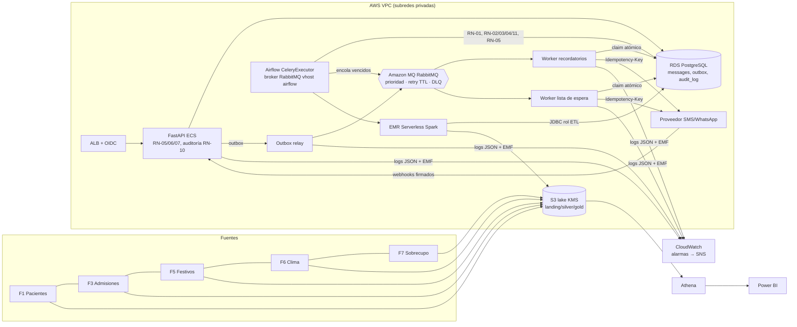

# Arquitectura v2: ClínicaRed Citas (US 04–06)

| Capa | Paquete | Responsabilidad |
|---|---|---|
| Dominio | `src/domain` | Reglas RN-01..RN-11 puras (sin E/S), llaves de idempotencia, calendario, privacidad |
| Servicios | `src/services` | Casos de uso: despacho, webhooks, citas, lista de espera, riesgo, admisiones y orquestación |
| Adaptadores | `src/repositories`, `src/gateways`, `src/messaging` | PostgreSQL, proveedor HTTP, RabbitMQ |
| Entradas | `src/api`, `src/workers`, `dags/`, `spark/jobs` | HTTP, consumidores, DAGs y jobs |

Decisiones: ADR 004 a ADR 010.
